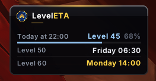
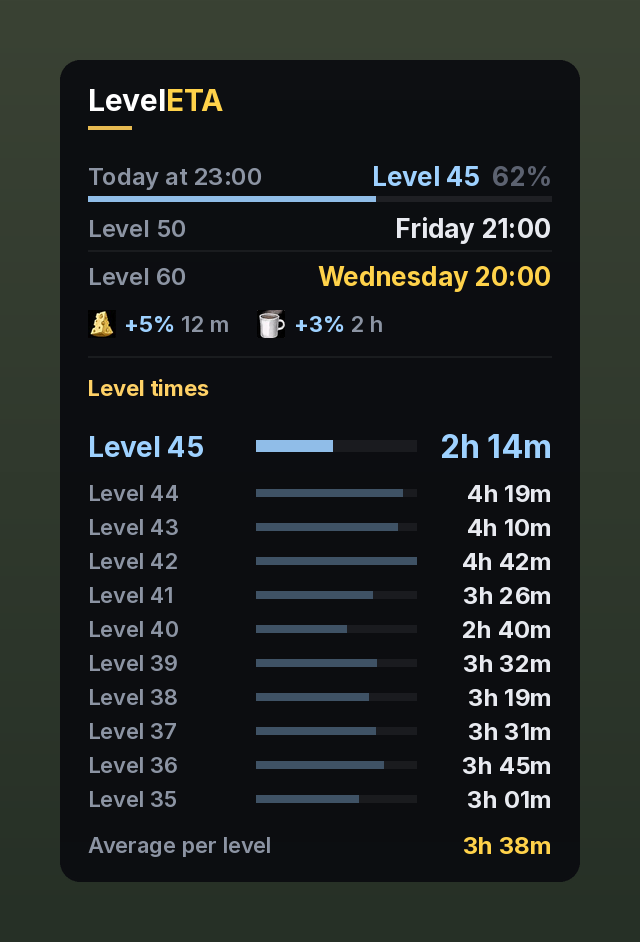
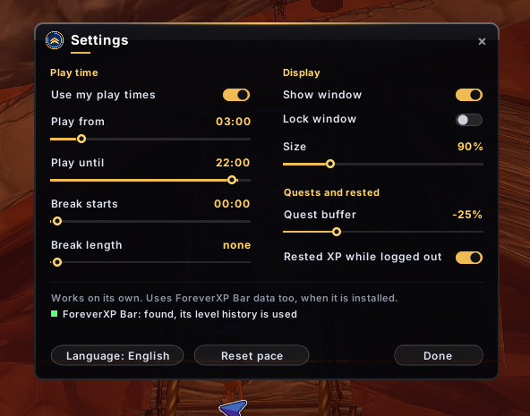

# LevelETA

**When will I hit my next level milestone, and level 60?**

LevelETA is a small, clean window for World of Warcraft: Forever that answers three questions while you level:

| Row | What it tells you |
|---|---|
| **Today at 22:00** | Which level you will be at when you stop playing today, with a thin bar showing how far into that level |
| **Level 50** | When you reach your next tenth level (10, 20, 30, 40 or 50) |
| **Level 60** | When you reach max level |

Times are shown as real dates: *Tomorrow at 07:00*, *Friday at 18:30*, *Nov 21 at 16:15*.

### Level times (optional)

Turn on **Show level times** in the settings to see how long each of your last levels took. You choose how many levels the list shows (3 to 30, 10 by default). The level you are on now is shown larger, in blue, and counts up while you play, and your average per level is shown at the bottom. It is off by default.

---

## Works on its own, and with ForeverXP Bar

**On its own:** LevelETA needs no other addon.
- It asks the game for your `/played` time (silently, nothing appears in chat), so it knows exactly how long you have been on your current level from the first minute.
- It records your play time every time you level up, so it gets more precise the more you play.
- Until it has enough data, it uses an estimate based on your level.

**With [ForeverXP Bar](https://www.curseforge.com/wow/addons/foreverxpbar):** if ForeverXP Bar is installed, LevelETA also reads its level history.
- You get accurate estimates from day one, based on every level ForeverXP Bar has recorded.
- LevelETA keeps a copy of that history, so nothing is lost if you remove ForeverXP Bar later.
- The settings window shows whether ForeverXP Bar was found.

When several sources have data for the same level (`/played`, ForeverXP Bar and LevelETA's own measurements), they are compared. If they agree, the average is used. If they disagree, the most precise source wins.

---

## How the estimate works

The part that is exact:
- The XP you still need, taken from the game and the official Forever XP table (2,642,800 XP from level 43 to 60, for example).
- XP from completed quests you have not turned in yet (minus a buffer you choose, because you do not always turn them all in).
- Your rested XP, plus the rested XP you will gain while logged out in an inn.

The part that is an estimate: **how fast you earn XP**.
- LevelETA looks at how long your last 12 levels took. Recent levels count the most, and odd levels (long AFK, boosts) are ignored.
- Your pace right now is mixed in: up to 40 % for today's estimate, only 10 % for level 50 and 60, so one good or bad hour does not move a date days away.
- Higher levels need more XP but also give more XP per kill and quest. LevelETA accounts for both. This model was tested against real leveling data and was on average about 6 % off over 6 levels.
- Your play schedule is respected: if you only play from 19:00 to 21:00, the dates reflect that.

---

## Settings

Right click the minimap button, or type `/lp`.

| Setting | What it does |
|---|---|
| **Use my play times** | Turn the play schedule on or off |
| **Play from / Play until** | When you usually play each day |
| **Break starts / Break length** | An optional daily break. Short breaks while logged in are already counted, so most players can leave this at *none* |
| **Show window / Lock window / Size** | Display options |
| **Show level times** | Show how long each of your last levels took (off by default) |
| **Levels in the list** | How many levels the level times list shows (3 to 30, default 10) |
| **Quest buffer** | How much of your ready quest XP to ignore (default 25 %) |
| **Rested XP while logged out** | Count rested XP gained while logged out in an inn |
| **Language** | English or Danish |
| **Reset pace** | Start measuring your current pace from scratch |

## Commands

- `/lp` or `/leveleta`: open settings
- `/lp show`: show or hide the window

Left click the minimap button to show or hide the window.

---

## Dansk

LevelETA viser, hvilket level du er på, når du stopper med at spille i dag, hvornår du rammer dit næste tiende level, og hvornår du rammer level 60.

Den virker helt alene og bruger `/played` og sine egne målinger. Er ForeverXP Bar installeret, bruger den også dens levelhistorik, så den er præcis fra første dag. Indstillinger: højreklik på minimap-knappen eller skriv `/lp`. Sproget kan skiftes til dansk i indstillingerne. Under Visning kan du slå level-tider til og se, hvor lang tid dine sidste levels tog. Du vælger selv, hvor mange levels listen viser.

---

## Credits

- Made by Rasmus.
- Font: [Inter](https://rsms.me/inter/) by The Inter Project Authors, licensed under the SIL Open Font License 1.1 (see `Fonts/LICENSE-Inter.txt`).
- XP table: World of Warcraft: Forever (same curve as Classic).
