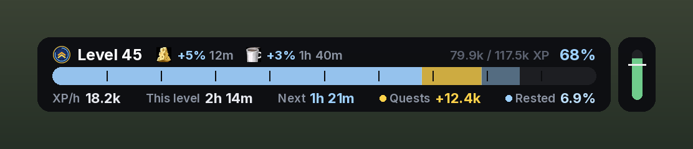

# LevelETA

**LevelETA tells you when you will reach your next levels.**

- **When you hit your next tenth level and level 60**, as real dates like *Friday 18:30*
- **What level you will be when you stop playing today**
- **An XP bar and XP tracker**: XP per hour, time to next level, quest XP, rested XP and XP buffs
- **Optional extras:** your level times and an activity bar with a goal

It learns how fast you level and knows when you play. **Every part can be turned on or off**, so you can use only what you want, for example just the XP bar or just the level times. Works on its own, and uses ForeverXP Bar data if you have it.

---

## What the window shows

The window answers three questions while you level:

| Row | What it tells you |
|---|---|
| **Today at 22:00** | Which level you will be at when you stop playing today, with a thin bar showing how far into that level |
| **Level 50** | When you reach your next tenth level (10, 20, 30, 40 or 50) |
| **Level 60** | When you reach max level |

Times are shown as real dates: *Tomorrow at 07:00*, *Friday at 18:30*, *Nov 21 at 16:15*.

### Level times (optional)

Turn on **Show level times** in the settings to see how long each of your last levels took. You choose how many levels the list shows (3 to 30, 10 by default). The level you are on now is shown larger, in blue, and counts up while you play, and your average per level is shown at the bottom. It is off by default.

### XP bar and XP tracker

LevelETA comes with an XP bar and XP tracker in the same style. It shows your XP, completed quests you have not turned in (gold) and your rested XP (light blue), with XP per hour, time to next level, ready quest XP and rested XP in percent below the bar. Active XP buffs (food and the Cozy Sleeping Bag) are shown with the time they have left. Hover the bar for kills and quests to level and stats for this session. The bar is shown at the top of the screen by default and replaces Blizzard's own XP bar. You can move it, turn it off, or show Blizzard's bar again in the settings.

Next to the XP bar is a small **activity bar**. It shows how much of the last 10 minutes you were active (fighting, earning XP or turning in quests). Hover it to see how your time on this level and this session splits into fighting and questing, travelling, flying, town, AFK and dead.

Click the activity bar (or type `/lp goal`) to set a **goal**, for example level 60 before Monday 05:00. A white line on the activity bar then shows how active you need to be to make it, based on your pace and your play schedule. The bar turns green when you are above the line and red when you are below. The tooltip shows when you will reach the goal at your current pace and how far ahead or behind you are.

When you have an XP buff, it is also shown in the window under the three rows.

---

## Works on its own, and with ForeverXP Bar

**On its own:** LevelETA needs no other addon.
- It asks the game for your `/played` time (silently, nothing appears in chat), so it knows exactly how long you have been on your current level from the first minute.
- It records your play time every time you level up, so it gets more precise the more you play.
- Until it has enough data, it uses an estimate based on your level.

**With [ForeverXP Bar](https://www.curseforge.com/wow/addons/foreverxpbar):** if ForeverXP Bar is installed, LevelETA also reads its level history.
- You get accurate estimates from day one, based on every level ForeverXP Bar has recorded.
- LevelETA keeps a copy of that history, so nothing is lost if you remove ForeverXP Bar later.
- The settings window shows whether ForeverXP Bar was found.

When several sources have data for the same level (`/played`, ForeverXP Bar and LevelETA's own measurements), they are compared. If they agree, the average is used. If they disagree, the most precise source wins.

---

## How the estimate works

The part that is exact:
- The XP you still need, taken from the game and the official Forever XP table (2,642,800 XP from level 43 to 60, for example).
- XP from completed quests you have not turned in yet (minus a buffer you choose, because you do not always turn them all in).
- Your rested XP, plus the rested XP you will gain while logged out in an inn.
- XP buffs for the time they have left: food buffs (+5% XP from kills, lost when you die) and the Cozy Sleeping Bag (+1% XP per stack, up to 3%). Rested XP from a Camp Tent at a campfire counts like any other rested XP.

The part that is an estimate: **how fast you earn XP**.
- LevelETA looks at how long your last 12 levels took. Recent levels count the most, and odd levels (long AFK, boosts) are ignored.
- Your pace right now is mixed in: up to 40 % for today's estimate, only 10 % for level 50 and 60, so one good or bad hour does not move a date days away.
- Higher levels need more XP but also give more XP per kill and quest. LevelETA accounts for both. This model was tested against real leveling data and was on average about 6 % off over 6 levels.
- Your play schedule is respected: if you only play from 19:00 to 21:00, the dates reflect that.

---

## Settings

Right click the minimap button, or type `/lp`.

The settings are split into three tabs. Every part of LevelETA can be turned on or off on its own.

| Tab | Settings |
|---|---|
| **Window** | Show window, lock window, minimap button, size. Choose which rows to show: *level when I stop today*, *next tenth level*, *level 60* and *XP buffs*. Level times on or off, and how many levels the list shows (3 to 30) |
| **XP bar** | Show XP bar, hide Blizzard's XP bar, bar size. Numbers under the bar, XP buffs on the bar and the activity bar, each on or off. Set goal |
| **Play time** | Use my play times, play from, play until, an optional daily break. Quest buffer (how much ready quest XP to ignore, default 25 %) and rested XP while logged out |

At the bottom: **Language** (English or Danish) and **Reset pace** (start measuring your current pace from scratch).

## Commands

- `/lp` or `/leveleta`: open settings
- `/lp show`: show or hide the window
- `/lp goal`: set a goal

Left click the minimap button to show or hide the window.

---

## Dansk

LevelETA viser, hvilket level du er på, når du stopper med at spille i dag, hvornår du rammer dit næste tiende level, og hvornår du rammer level 60.

Den virker helt alene og bruger `/played` og sine egne målinger. Er ForeverXP Bar installeret, bruger den også dens levelhistorik, så den er præcis fra første dag. Indstillinger: højreklik på minimap-knappen eller skriv `/lp`. Sproget kan skiftes til dansk i indstillingerne, og alle dele kan slås til og fra hver for sig. Under fanen Vindue kan du slå level-tider til og se, hvor lang tid dine sidste levels tog. Du vælger selv, hvor mange levels listen viser. Under fanen XP-bar kan du slå en XP-bar til i samme stil og skjule Blizzards egen. Ved siden af baren viser en lille bjælke, hvor aktiv du er. Klik på den for at sætte et mål, så viser en hvid streg, hvor aktiv du skal være for at nå det.

---

## Credits

- Made by Rasmus.
- Font: [Inter](https://rsms.me/inter/) by The Inter Project Authors, licensed under the SIL Open Font License 1.1 (see `Fonts/LICENSE-Inter.txt`).
- XP table: World of Warcraft: Forever (same curve as Classic).
